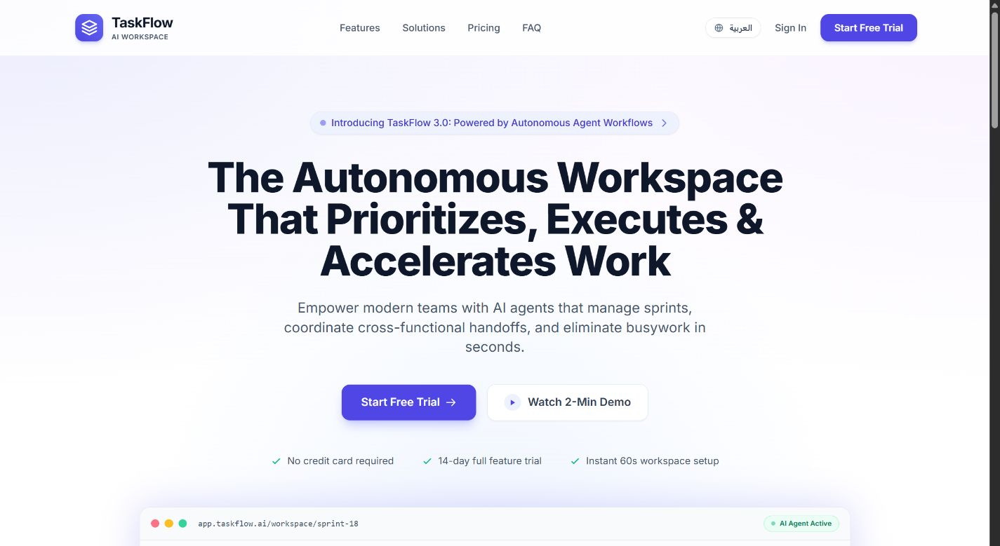

# TaskFlow AI Workspace | مساحة عمل TaskFlow

A SaaS landing page presenting a concept for AI-assisted workflow management. It combines a product preview with interactive billing and currency controls, FAQ accordions, and illustrative signup flows in responsive Arabic and English layouts.

[Live demo](https://eng-ayatnassar.github.io/taskflow-saas/) · [Source code](https://github.com/eng-ayatnassar/taskflow-saas) · [Ayat Nassar's portfolio](https://eng-ayatnassar.github.io/)



## Overview

Designed and developed by **Ayat Nassar** as a bilingual front-end portfolio project. The interface supports English and Arabic RTL, responsive layouts, and practical client-side interactions.

## Features

- Responsive product storytelling and interface mockup
- Monthly/yearly pricing and display-currency selection
- FAQ accordions and demo preview feedback
- Illustrative sign-in/signup modals and Arabic RTL

## Tech stack

HTML5 · JavaScript · Tailwind CSS · Vite

## Run locally

Requires **Node.js 22.12 or newer**.

```bash
npm ci
npm run dev
```

On Windows, you can also run `start.cmd`.

## Production build

```bash
npm run build
npm run preview
```

The build is written to `dist/`. Relative asset paths support deployment under a GitHub Pages repository path.

## Demo scope

**Frontend Demo.** Marketing concept only. Authentication, AI agents, integrations, and commercial product claims shown in the page are illustrative, not connected services. Use fictional input when trying forms. External imagery and fonts depend on their providers.

## Deployment

The GitHub Actions workflow installs locked dependencies, checks known high-severity advisories, builds, and deploys to GitHub Pages on pushes to `main`. Pull requests run the build without deployment. Repository Pages settings use **GitHub Actions** as the source.

Source, lockfiles, and preview images are tracked. `node_modules/`, `dist/`, secrets, and local logs are excluded.

## بالعربية

صفحة هبوط تصوّر منصة لإدارة العمل بمساعدة الذكاء الاصطناعي، وتجمع عرض المزايا مع تسعير تفاعلي حسب الفوترة والعملة وأسئلة شائعة ونماذج تسجيل توضيحية ضمن تصميم متجاوب باللغتين.

- عرض متجاوب للمزايا ونموذج لواجهة المنتج
- أسعار شهرية وسنوية وتبديل عملة العرض
- أسئلة شائعة تفاعلية ورسائل المعاينة
- نماذج تسجيل توضيحية ودعم العربية RTL

هذا المشروع عرض Frontend لمعرض الأعمال، وليس خدمة تجارية متصلة بخادم أو نظام دفع أو حسابات حقيقية.
